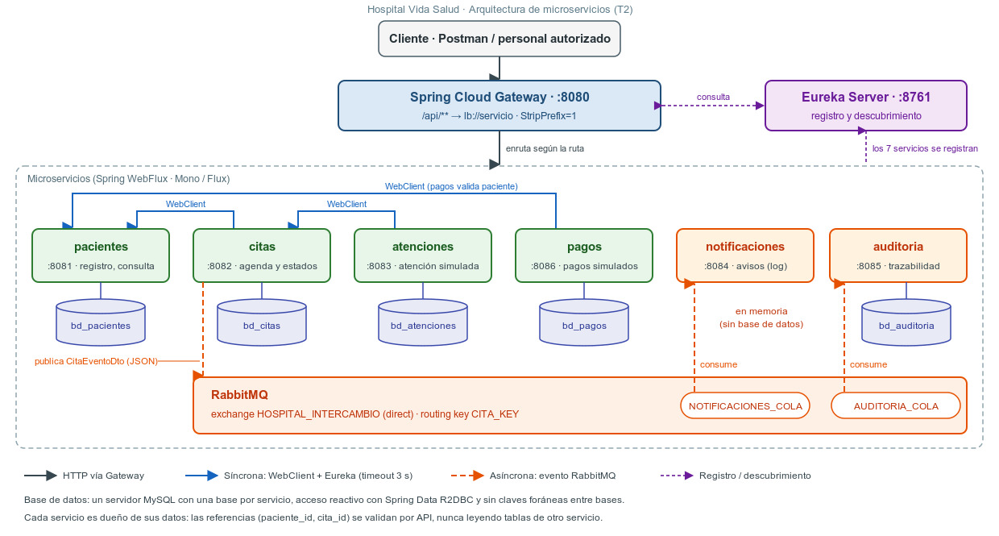
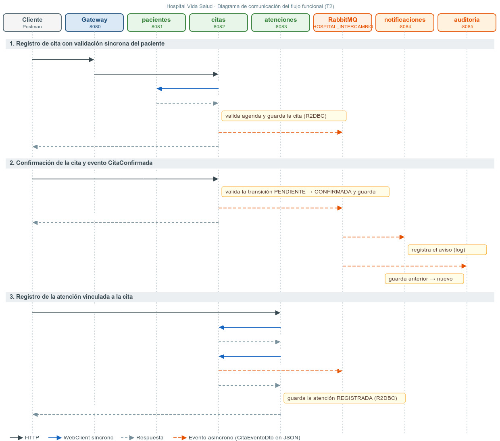
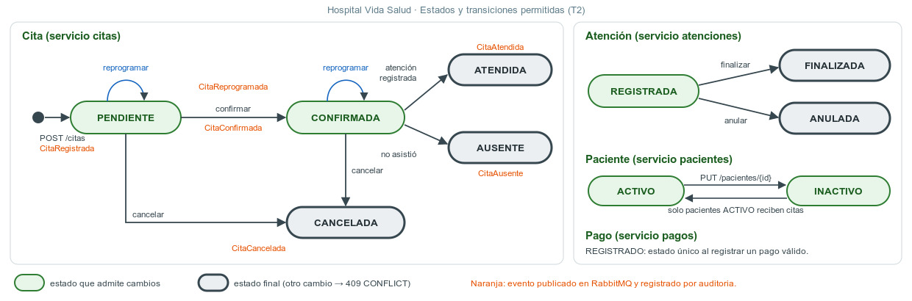
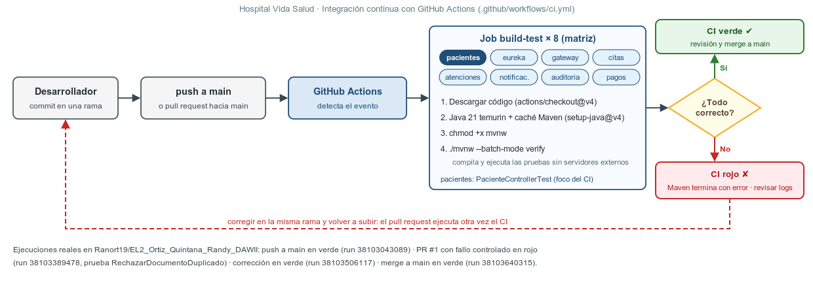

# Documento técnico · Hospital Vida Salud

**Curso:** 4698 Desarrollo de Aplicaciones Web II · **Evaluación:** Segunda Evaluación T2
**Profesor:** Zambrano Macedo, Yuri Renzo · **Alumno:** Ortiz Quintana, Randy
**Repositorio:** https://github.com/Ranort19/EL2_Ortiz_Quintana_Randy_DAWII

Sistema académico. No se usa para diagnosticar ni para tomar decisiones clínicas. Todos los datos de prueba son ficticios.

## 1. Descripción del problema y alcance

El Hospital Vida Salud utiliza una aplicación monolítica que concentra pacientes, citas, atención, laboratorio, hospitalización, farmacia, facturación, notificaciones y reportes. Esto provoca alto acoplamiento, despliegues riesgosos, demoras en horas de alta afluencia, duplicación de información y fallos que afectan a todos los módulos a la vez.

La solución divide el sistema en microservicios con responsabilidades de negocio propias, un punto de entrada único (Spring Cloud Gateway), descubrimiento dinámico (Eureka), comunicación síncrona con WebClient y asíncrona con RabbitMQ, persistencia reactiva con Spring Data R2DBC sobre MySQL, y un proceso de integración continua con GitHub Actions.

### 1.1 Alcance implementado

| Proceso del caso | Implementado | Microservicio |
|---|---|---|
| Registro, consulta, actualización y duplicados de pacientes | Sí | pacientes |
| Programación, reprogramación, cancelación y estados de citas | Sí | citas |
| Atención administrativa vinculada a una cita | Sí | atenciones |
| Notificaciones de cambios de cita | Sí (log y memoria) | notificaciones |
| Auditoría y trazabilidad de cambios de estado | Sí | auditoria |
| Pagos simulados (monto válido y operación única) | Sí, básico | pagos |
| Laboratorio | No (opcional según §27) | — |
| Hospitalización y farmacia | No (referenciales) | — |
| Facturación y cargos | No (fuera del alcance básico de pagos) | — |

**Justificación de la selección.** El PDF indica que no es obligatorio implementar todos los módulos con la misma profundidad, pero sí entregar un flujo funcional de extremo a extremo (§16). Se implementó el flujo mínimo del §27 (paciente → cita → confirmación → evento → notificaciones y auditoría → atención → persistencia → pruebas → CI). Pagos se incluyó porque el §24 pide probar la validación de un monto de pago no permitido. Laboratorio está marcado como opcional en el §27, y hospitalización y farmacia no aparecen en las pruebas funcionales obligatorias (§28) ni en la rúbrica.

## 2. Análisis del negocio

### 2.1 Actores

| Actor | Interacción con el sistema |
|---|---|
| Paciente | Recibe avisos de registro, confirmación, reprogramación, cancelación y atención de sus citas |
| Personal de admisión | Registra y actualiza pacientes; programa, confirma, reprograma y cancela citas |
| Personal de salud | Registra la atención administrativa de una cita confirmada |
| Caja / administración | Registra pagos simulados |
| Administrador del sistema | Supervisa los servicios en Eureka, las colas en RabbitMQ y la auditoría |
| Equipo de desarrollo | Mantiene el código y el flujo de integración continua |

### 2.2 Reglas de negocio implementadas

| Regla | Dónde se valida | Respuesta |
|---|---|---|
| Un paciente no se repite por tipo y número de documento | PacienteModel + UNIQUE en SQL | 409 |
| Datos obligatorios del paciente, fecha de nacimiento no futura, estado ACTIVO o INACTIVO | PacienteModel | 400 |
| Una cita requiere paciente existente y ACTIVO | CitaModel + PacienteUseCase (WebClient) | 400 |
| La cita requiere especialidad válida, fecha futura, profesional y motivo breve (máximo 150 caracteres) | CitaModel | 400 |
| Un profesional no tiene dos citas activas a la misma hora; un paciente tampoco | CitaModel (ValidarAgenda) | 409 |
| Solo se permiten las transiciones de estado definidas; no se confirma una cita CANCELADA | CitaModel (TRANSICIONES) | 409 |
| Solo se reprograma una cita PENDIENTE o CONFIRMADA | CitaModel | 409 |
| Una atención requiere una cita CONFIRMADA y solo existe una atención por cita | AtencionModel + UNIQUE cita_id | 409 |
| Un pago debe tener monto mayor que cero | PagoModel + CHECK en SQL | 400 |
| El número de operación de un pago no se repite | PagoModel + UNIQUE en SQL | 409 |
| Los cambios importantes de estado publican un evento y quedan auditados | CitaModel → RabbitMQ → auditoria | — |

### 2.3 Entidades y eventos

| Entidad | Servicio dueño | Identificador | Referencias a otros servicios |
|---|---|---|---|
| Paciente | pacientes | id | — |
| Cita | citas | id, codigo | paciente_id |
| Atencion | atenciones | id, codigo | paciente_id, cita_id |
| Pago | pagos | id, numero_operacion | paciente_id |
| Auditoria | auditoria | id | recurso_id (cita) |

Eventos publicados por citas: **CitaRegistrada, CitaConfirmada, CitaReprogramada, CitaCancelada, CitaAtendida y CitaAusente**.

### 2.4 Supuestos

- La agenda es simplificada: se valida por profesional y por paciente en la misma fecha y hora, sin horarios laborales ni duración de cita.
- Marcar una cita como ATENDIDA o AUSENTE no exige que la fecha ya haya pasado, para poder demostrar el flujo.
- Las notificaciones se simulan con log y una lista en memoria (§13 lo permite).
- Pagos solo registra pagos simulados; no genera cargos ni facturas.

## 3. Identificación de microservicios

### 3.1 Responsabilidades y datos

| Servicio | Puerto | Responsabilidad | Base de datos |
|---|---|---|---|
| eureka-server | 8761 | Registro y descubrimiento de servicios | — |
| gateway | 8080 | Punto de entrada único | — |
| pacientes | 8081 | Registro, consulta, actualización y validación de duplicados | bd_pacientes |
| citas | 8082 | Agenda, estados, reprogramación y publicación de eventos | bd_citas |
| atenciones | 8083 | Atención administrativa simulada vinculada a una cita | bd_atenciones |
| notificaciones | 8084 | Avisos al paciente a partir de eventos | En memoria |
| auditoria | 8085 | Trazabilidad de cambios de estado | bd_auditoria |
| pagos | 8086 | Pagos simulados | bd_pagos |

### 3.2 Operaciones, eventos y dependencias

| Servicio | Endpoints principales | Eventos | Depende de |
|---|---|---|---|
| pacientes | POST /pacientes, GET /pacientes, GET /pacientes/{id}, GET /pacientes/documento/{tipo}/{numero}, PUT /pacientes/{id} | — | — |
| citas | POST /citas, GET /citas, GET /citas/{id}, GET /citas/paciente/{id}, PUT /citas/{id}/estado, PUT /citas/{id}/reprogramar | Publica eventos de cita | pacientes (WebClient), RabbitMQ |
| atenciones | POST /atenciones, GET /atenciones, GET /atenciones/{id}, GET /atenciones/cita/{citaId}, PUT /atenciones/{id}/estado | — | citas (WebClient) |
| notificaciones | GET /notificaciones | Consume NOTIFICACIONES_COLA | RabbitMQ |
| auditoria | GET /auditoria, GET /auditoria/recurso/{id} | Consume AUDITORIA_COLA | RabbitMQ |
| pagos | POST /pagos, GET /pagos, GET /pagos/paciente/{id} | — | pacientes (WebClient) |

## 4. Diagramas

### 4.1 Diagrama de arquitectura



### 4.2 Diagrama de comunicación del flujo funcional



### 4.3 Estados y transiciones



## 5. Diseño de datos

Un servidor MySQL contiene cinco bases independientes, una por servicio. El script completo está en `script/hospital.sql`.

| Tabla (base) | Clave primaria | Restricciones | Índices |
|---|---|---|---|
| paciente (bd_pacientes) | id | UNIQUE (tipo_documento, numero_documento); NOT NULL en datos obligatorios | El del UNIQUE |
| cita (bd_citas) | id | UNIQUE codigo | paciente_id; (profesional_codigo, fecha_hora) |
| atencion (bd_atenciones) | id | UNIQUE codigo; UNIQUE cita_id | paciente_id |
| auditoria (bd_auditoria) | id | estado_anterior admite nulos (evento de registro) | (recurso, recurso_id) |
| pago (bd_pagos) | id | UNIQUE numero_operacion; CHECK monto > 0 | paciente_id |

**Propiedad de los datos.** Cada servicio es el único que lee y escribe sus tablas. Cuando atenciones necesita marcar una cita como ATENDIDA, no modifica la tabla cita: llama a la API de citas, que aplica sus propias reglas de transición. Las referencias entre servicios (paciente_id, cita_id) se validan por API, no con claves foráneas.

**Limitación documentada.** Por motivos académicos se usa un único servidor MySQL. Las bases son independientes, no hay claves foráneas entre ellas y ningún servicio accede a las tablas de otro. En producción cada base podría estar en un servidor distinto sin cambiar el código, solo la URL de conexión.

## 6. Endpoints y contratos entre servicios

Todas las rutas externas pasan por el gateway con el prefijo `/api`, por ejemplo `POST http://localhost:8080/api/pacientes`.

### 6.1 Contratos síncronos (WebClient)

| Llamada | Contrato | Error del destino → respuesta | Tiempo de espera | Indisponibilidad |
|---|---|---|---|---|
| citas → pacientes | `GET http://pacientes/pacientes/{id}` → PacienteDto (id, tipoDocumento, numeroDocumento, nombres, apellidos, estado) | 4xx → 400 "El paciente no existe" | 3 s | 503 "El servicio de pacientes no esta disponible" |
| pagos → pacientes | Igual al anterior | 4xx → 400 | 3 s | 503 |
| atenciones → citas | `GET http://citas/citas/{id}` → CitaDto (id, codigo, pacienteId, especialidad, fechaHora, estado) | 4xx → 400 "La cita no existe" | 3 s | 503 "El servicio de citas no esta disponible" |
| atenciones → citas | `PUT http://citas/citas/{id}/estado` con `{"estado":"ATENDIDA"}` | 4xx → 409 | 3 s | 503 |

"Indisponibilidad" cubre: sin instancias registradas en Eureka, tiempo de espera agotado o error 5xx del destino. En todos los casos el error se transforma en una respuesta HTTP clara, sin datos parciales.

### 6.2 Contrato del evento (RabbitMQ)

| Elemento | Valor |
|---|---|
| Exchange | HOSPITAL_INTERCAMBIO (direct, durable) |
| Routing key | CITA_KEY |
| Colas | NOTIFICACIONES_COLA y AUDITORIA_COLA (durables) |
| Productor | citas (RabbitMQModel) |
| Consumidores | notificaciones y auditoria (ConsumidorComponent con @RabbitListener) |
| Formato | JSON con JacksonJsonMessageConverter |

```
{
  "evento": "CitaConfirmada",
  "citaId": 1,
  "codigo": "CIT-1760140000000",
  "pacienteId": 1,
  "fechaHora": "2027-03-15T09:00:00",
  "estadoAnterior": "PENDIENTE",
  "estadoNuevo": "CONFIRMADA",
  "fecha": "2026-10-10T19:36:28",
  "origen": "citas"
}
```

Los dos consumidores tienen una copia de `CitaEventoDto` en su propio paquete. No comparten código con citas: solo comparten el contrato JSON.

## 7. Comunicación síncrona y asíncrona

**Síncrona (WebClient).** Se usa cuando la operación no puede continuar sin una respuesta inmediata: no se puede registrar una cita sin saber si el paciente existe y está ACTIVO, ni una atención sin saber si la cita está CONFIRMADA. El cliente recibe en la misma petición el resultado o un error claro.

**Asíncrona (RabbitMQ).** Se usa para procesos secundarios que no deben bloquear ni hacer fallar la operación principal: avisar al paciente y registrar la auditoría. Citas solo publica en el exchange y no conoce a sus consumidores, por lo que se pueden agregar consumidores nuevos sin modificar citas. Si notificaciones o auditoria están apagados, los eventos esperan en sus colas durables.

**Cómo se evita el acoplamiento.** El productor depende solo del exchange y la routing key. Cada consumidor declara su propia cola y su copia del contrato JSON. Si RabbitMQ no está disponible, citas guarda igualmente la cita y registra el error en el log; el evento se pierde (limitación aceptada para el alcance académico).

## 8. Tecnologías utilizadas

### 8.1 Spring Cloud Gateway

Recibe todas las peticiones en el puerto 8080 y las enruta según la ruta: `/api/pacientes/**` → `lb://pacientes`, y así para citas, atenciones, notificaciones, auditoria y pagos. El filtro `StripPrefix=1` quita `/api` antes de reenviar.

Los clientes no deben depender de los puertos internos porque esos puertos y la cantidad de instancias pueden cambiar sin aviso. Con un único punto de entrada el cliente usa siempre la misma dirección, `lb://` reparte la carga entre instancias, y el gateway es el lugar natural para agregar autenticación más adelante.

### 8.2 Eureka Discovery Server

Cada servicio se registra al arrancar con su `spring.application.name`. El gateway y los WebClient anotados con `@LoadBalanced` consultan el registro de Eureka para traducir un nombre lógico (por ejemplo `http://pacientes`) a la dirección real de una instancia disponible.

### 8.3 RabbitMQ

Exchange directo con una routing key y dos colas enlazadas, una por consumidor. Cada evento llega a las dos colas, así cada consumidor recibe su propia copia y procesa a su ritmo.

### 8.4 Spring WebFlux, Mono y Flux

- **Mono** para operaciones de cero o un resultado: registrar, buscar por id, actualizar, cambiar de estado.
- **Flux** para colecciones: listar pacientes, citas por paciente, historial de auditoría.
- Los errores se emiten con `Mono.error(new ResponseStatusException(...))`, que WebFlux traduce al código HTTP.
- El flujo es reactivo desde el controlador hasta el repositorio. La publicación en RabbitMQ (que es bloqueante) se ejecuta en `Schedulers.boundedElastic()` para no bloquear los hilos de WebFlux.

La programación reactiva aporta valor en este caso porque los servicios pasan buena parte del tiempo esperando entrada y salida (base de datos y llamadas a otros servicios). Con pocos hilos se atienden muchas peticiones simultáneas, lo que responde al problema de saturación en horarios de alta afluencia.

### 8.5 Spring Data R2DBC

Todos los repositorios extienden `ReactiveCrudRepository` y usan el driver reactivo `io.asyncer:r2dbc-mysql`. No hay JDBC en ningún servicio. Las consultas derivadas (`existsByNumeroOperacion`, `findByTipoDocumentoAndNumeroDocumento`, etc.) devuelven Mono o Flux.

## 9. Estados y trazabilidad

| Recurso | Estados | Transiciones permitidas |
|---|---|---|
| Cita | PENDIENTE, CONFIRMADA, ATENDIDA, CANCELADA, AUSENTE | PENDIENTE → CONFIRMADA o CANCELADA; CONFIRMADA → ATENDIDA, CANCELADA o AUSENTE; reprogramar solo en PENDIENTE o CONFIRMADA |
| Atención | REGISTRADA, FINALIZADA, ANULADA | REGISTRADA → FINALIZADA o ANULADA |
| Paciente | ACTIVO, INACTIVO | Cambio mediante PUT /pacientes/{id} |
| Pago | REGISTRADO | Estado único |

Cada cambio de estado de una cita genera un registro en auditoría con fecha, recurso, identificador, estado anterior, estado nuevo, evento y origen, como pide el §14. Se consulta con `GET /api/auditoria/recurso/{id}`.

## 10. Pruebas automatizadas

Las pruebas se ejecutan con `./mvnw verify` y no necesitan MySQL, RabbitMQ ni Eureka: los repositorios y los servicios externos se reemplazan con Mockito.

| Requisito del §24 | Prueba | Tipo |
|---|---|---|
| Registro de paciente válido | PacienteControllerTest.RegistrarPacienteCorrecto | Controlador (WebTestClient) |
| Rechazo de paciente duplicado | PacienteControllerTest.RechazarDocumentoDuplicado | Controlador |
| Recurso inexistente | PacienteControllerTest.ConsultarPacienteInexistente | Controlador |
| Registro y consulta de cita | CitaModelTest.RegistrarCitaCorrecta y ConsultarCitaPorId | Unitaria (StepVerifier) |
| Transición de estado no permitida | CitaModelTest.RechazarTransicionNoPermitida | Unitaria |
| Publicación y consumo de un evento | CitaModelTest.ConfirmarCitaPublicaEventoCitaConfirmada y ConsumidorComponentTest | Unitaria |
| Monto de pago no permitido | PagoModelTest.RechazarMontoCero y RechazarMontoNegativo | Unitaria |

Además, PacienteControllerTest prueba datos inválidos, consulta por id y actualización (6 pruebas), y PagoModelTest prueba el número de operación duplicado y un pago válido. En total son 15 pruebas.

**Aclaración del profesor.** Se indicó que la integración continua se enfoque en un solo controlador. Se eligió **PacienteController**: es la única prueba de controlador y la que se usó para el fallo controlado. Las pruebas unitarias mínimas del §24 se mantienen porque el PDF las exige y la aclaración no las elimina.

## 11. Integración continua



El workflow `.github/workflows/ci.yml` se ejecuta en cada push a `main` y en cada pull request hacia `main`. El repositorio tiene ocho proyectos Maven independientes, por eso se usa una **matriz** con un job por proyecto. Cada job realiza los pasos del ejemplo del §25.4:

1. Descargar el código (`actions/checkout@v4`).
2. Configurar Java 21 temurin con caché de Maven (`actions/setup-java@v4`).
3. Dar permiso de ejecución a `mvnw`.
4. Ejecutar `./mvnw --batch-mode verify`, que compila, ejecuta las pruebas y empaqueta.

Con `fail-fast: false`, si un proyecto falla los demás terminan igual y se ve exactamente cuál falló.

**Qué ocurre cuando algo falla.** Si la compilación o una prueba falla, Maven termina con un código de salida distinto de cero, el job queda en rojo y el pull request muestra el check fallido. Para impedir que se integre un cambio defectuoso se puede activar en GitHub una regla de protección de `main` que exija que los checks pasen antes del merge.

**Ejecuciones realizadas.**

| Ejecución | Evento | Resultado |
|---|---|---|
| Run 38103043089 | Push inicial a main | Verde, 8 jobs |
| Run 38103389478 | PR #1, commit 68bba09 (respuesta de duplicado cambiada a 400) | Rojo: falla build-test (pacientes), prueba RechazarDocumentoDuplicado |
| Run 38103506117 | PR #1, commit a5e0fd2 (respuesta 409 restaurada) | Verde, 8 jobs |
| Run 38103640315 | Merge del PR #1 a main | Verde, 8 jobs |

## 12. Seguridad y datos de prueba

- Todos los datos son ficticios: documentos inventados (DNI 90000001, CE 900000002, pasaporte PX0000003), correos `@correo.test` y motivos administrativos sin información clínica.
- No hay contraseñas en el repositorio: se usan las variables de entorno `DB_USERNAME`, `DB_PASSWORD`, `RABBITMQ_USERNAME` y `RABBITMQ_PASSWORD`.
- Los mensajes de notificación y los logs solo contienen identificadores, no nombres ni documentos.
- El `.gitignore` excluye `target/`, logs y archivos `.env`.

## 13. Instrucciones de ejecución y pruebas

1. Requisitos: Java 21, MySQL 8 y RabbitMQ con el plugin de administración.
2. Ejecutar `script/hospital.sql` en MySQL.
3. En cada terminal, definir la contraseña de MySQL: `$env:DB_PASSWORD = "tu_clave"`.
4. Arrancar en este orden con `mvnw.cmd spring-boot:run`: eureka-server, gateway, y luego pacientes, citas, atenciones, notificaciones, auditoria y pagos.
5. Importar `postman/Hospital_Vida_Salud.json` en Postman y ejecutar la colección en orden.
6. Pruebas automatizadas: en la carpeta de un servicio, ejecutar `mvnw.cmd verify`.

## 14. Limitaciones

- No hay transacciones distribuidas: si citas marca una cita como ATENDIDA y luego falla el guardado de la atención, quedarían inconsistentes. El riesgo es bajo porque el guardado es local.
- Si RabbitMQ no está disponible, la cita se guarda y el evento se pierde (queda en el log).
- Si auditoría no puede guardar un evento, el error queda en el log y ese registro se pierde.
- Las notificaciones se guardan en memoria y se pierden al reiniciar el servicio.
- No se implementó autenticación en el gateway.

## Anexo: Evidencias

Capturas de funcionamiento solicitadas en el §29 C. Se incluyen en la versión Word de este documento.

### A.1 Eureka con los servicios registrados

### A.2 Enrutamiento por el Gateway

### A.3 Endpoints y reglas de negocio

### A.4 Persistencia SQL con R2DBC

### A.5 RabbitMQ: evento publicado y consumido

### A.6 Pruebas automatizadas ejecutadas

### A.7 GitHub Actions: ejecución exitosa

### A.8 Fallo controlado y su corrección
